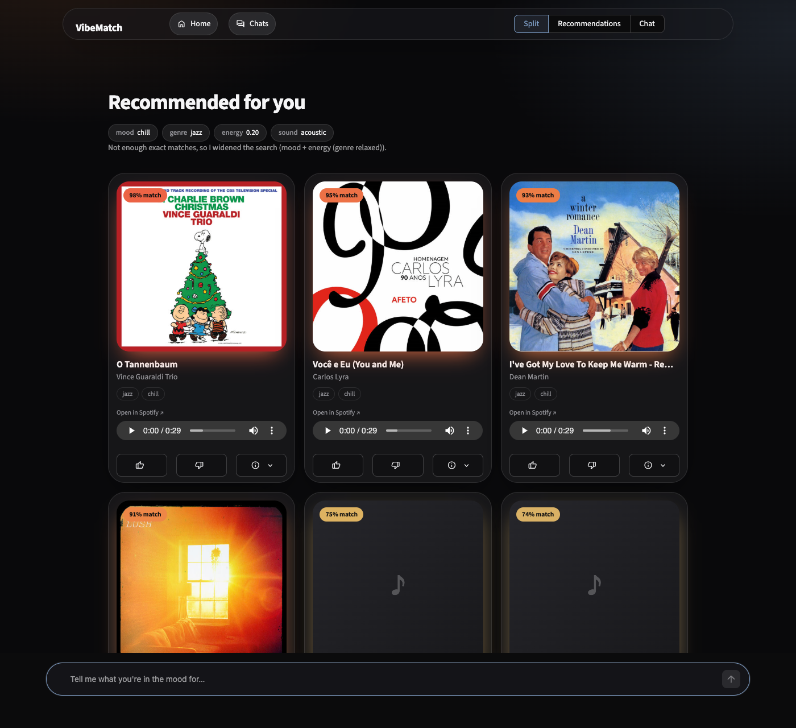
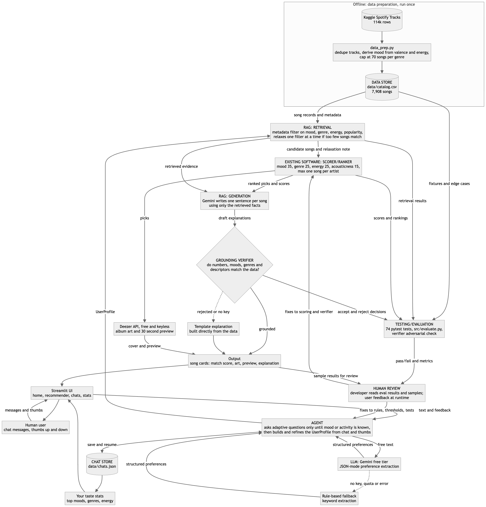
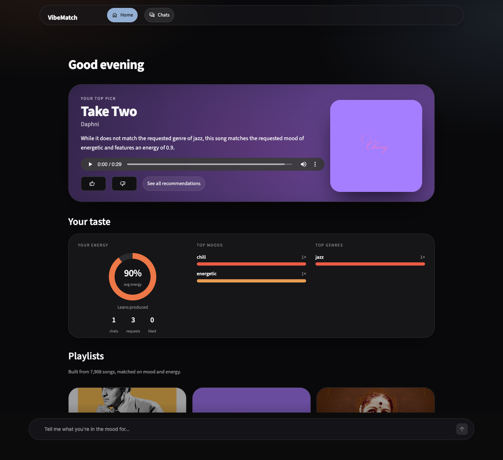
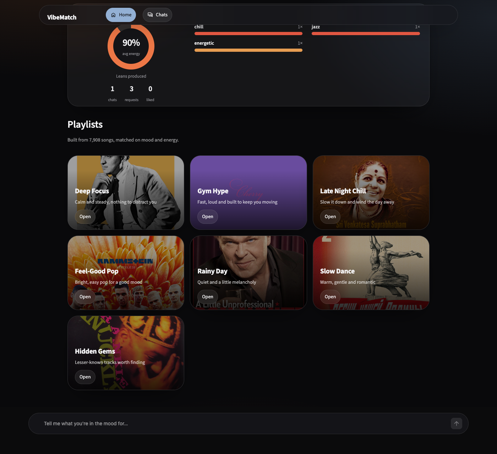

# 🎧 VibeMatch: a conversational music recommender with RAG and an agentic workflow

You tell it what you're in the mood for, in plain English. It asks only what it needs, searches a catalog of ~8,000 real songs, ranks the candidates with an explainable scoring model, and explains every pick using only facts from the data. You can then steer it with chat ("calmer", "more familiar") or thumbs up and down.



## Original project (Modules 1–3)

This builds on my **Music Recommender Simulation** (model name *VibeMatch 1.0*). It was a content-based recommender over a hand-written 20-song CSV. A fixed taste profile (favorite genre, favorite mood, target energy, acoustic preference) was scored against every song out of 100 (mood 35, genre 25, energy 25, acousticness 15), and a command-line script printed the top 5 with the points each one earned. I evaluated it on three profiles (pop, rock, lofi) and documented its biases in a model card.

That scoring function is still the core of the ranking step here. Everything around it is new: the conversation, the 400× larger catalog, retrieval, grounded explanations, feedback, and the UI.

## What it does and why it matters

Most "AI music" demos either hand a prompt to an LLM and trust whatever it says (it will invent songs and facts), or they are a static filter with no conversation. VibeMatch is a middle path that I think is how a lot of real applied-AI features should be built:

- the **LLM only does what it is good at** (understanding messy language and writing a friendly sentence),
- **deterministic code does what must be right** (which songs exist, how they are ranked, whether a claim is true),
- and **every AI step has a verified, offline fallback**, so the product keeps working when the model is wrong, rate-limited, or missing.

## AI features at a glance

| Feature | What it does | Where |
|---|---|---|
| **Agentic workflow** | A stateful agent runs a multi-step loop: decide what to ask, read the answer, decide when it knows enough, build and refine a user profile from chat and thumbs, then drive retrieval, ranking and explanation. It asks adaptive questions only until it knows your mood or activity, then recommends right away. | [src/agent.py](src/agent.py) |
| **RAG: retrieval** | Searches the 7,908-song catalog by mood, genre, energy and popularity. If too few songs match, it relaxes one filter at a time and records which, so the UI and the explanations stay honest. | [src/retrieval.py](src/retrieval.py) |
| **RAG: grounded generation** | Gemini writes one sentence per song from the retrieved facts only. A **verifier** then checks every quoted number, mood, genre and descriptor against the data. Anything that fails is replaced by a template built straight from the data. | [src/explain.py](src/explain.py) |
| **Feedback loop** | "More upbeat", "calmer", "less acoustic", "more familiar", "hidden gems", a brand-new request, or thumbs up and down all update the profile. | [src/agent.py](src/agent.py) |
| **Graceful degradation** | No key, no network, or a quota error never breaks the app. Gemini falls back to rule-based extraction, and explanations fall back to templates. | [src/llm.py](src/llm.py) |
| **Evaluation** | Offline evaluation over 64 profiles plus an adversarial test of the verifier. | [src/evaluate.py](src/evaluate.py) |

An honest note on "agentic": this is a lightweight, stateful, goal-directed workflow, not an autonomous agent that picks arbitrary tools. The agent decides *what to ask next*, *when it is ready*, and *how to change the profile*, and the surrounding pipeline acts on that. That was a deliberate scope choice (see Design Decisions).

## Architecture overview



The editable source is [diagrams/architecture.mmd](diagrams/architecture.mmd).

1. **Offline data prep.** [src/data_prep.py](src/data_prep.py) turns the 114k-row Kaggle "Spotify Tracks" file into `data/catalog.csv`: it removes duplicate tracks, derives a **mood** label from valence, energy and sound (the dataset has none), and caps each genre at 70 songs so no genre dominates.
2. **Agent.** Your messages go to the agent, which extracts preferences (Gemini in JSON mode, or the rule-based fallback) and builds a `UserProfile`.
3. **Retrieval.** The profile becomes a metadata query against the catalog and returns up to 100 candidates.
4. **Scorer/ranker.** The original VibeMatch 1.0 scoring function ranks the candidates, with at most one song per artist.
5. **Generation + verifier.** Gemini explains each pick from the retrieved facts; the verifier accepts or rejects each sentence; rejected ones become template explanations.
6. **Enrichment and UI.** Deezer's free, keyless API supplies album art and 30-second previews. The Streamlit UI shows cards, playlists, saved chats, and a "Your taste" stats panel.
7. **Testing and review.** Tests and the evaluation script feed a human review loop, and your thumbs and chat feedback are the runtime review loop back into the agent.

## Setup instructions

Requires Python 3.10+ (developed on 3.14). No paid services are needed.

```bash
# 1. Get the code and create an environment
git clone <this repo> && cd applied-ai-system-project
python -m venv .venv
source .venv/bin/activate            # Windows: .venv\Scripts\activate
pip install -r requirements.txt

# 2. (Optional but recommended) enable Gemini. It's free: https://aistudio.google.com/apikey
echo 'GEMINI_API_KEY=your-key-here' > .env
# optional: pick another model with GEMINI_MODEL=... in .env

# 3. Run the app
streamlit run app.py
```

- **The song catalog is included** (`data/catalog.csv`), so you don't need Kaggle to run the app. To rebuild it, download the [Spotify Tracks Dataset](https://www.kaggle.com/datasets/maharshipandya/-spotify-tracks-dataset) as `data/spotify_tracks_raw.csv` and run `python -m src.data_prep`.
- **Without a Gemini key** the app still works end to end, using rule-based language understanding and template explanations. With a key, Gemini reads your messages and writes the explanations (each one verified).
- `.env` and your saved chats (`data/chats.json`) are git-ignored.
- Command-line version: `python -m src.chat`.

```bash
pytest                    # 74 tests
python -m src.evaluate    # offline evaluation report (no network or key needed)
```

## Sample interactions

These are real outputs from the running system (catalog of 7,908 songs).

### 1. One message is enough

```
You:    late night studying, something calm
Agent:  (read via Gemini) mood=chill · energy 0.20 · acoustic

  1. First Love Waltz – Rashid Beibutov           [romance/chill]  87% match
     "Its chill mood matches what you asked for; its energy of 0.20 is very close to
      your 0.20 target; acousticness of 0.97 suits your taste for acoustic sound."
  2. Эх, дороги – Georgi Vinogradov, Red Army Choir [romance/chill]  86% match
  3. Paciencia – Juan D'Arienzo                    [tango/chill]    86% match
```

Gemini understood the message. Its free quota was used up for the explanations, so the data-built template wrote them, which is the fallback path working as designed. The agent did not ask any follow-up questions because it already knew the mood.

### 2. A request that changes with chat, and a grounded Gemini explanation

```
You:    gym, something loud
You:    hip hop
Agent:  mood=energetic · genre=hip-hop · energy 0.90 · produced sound

  1. Gunehgar – DIVINE                              [hip-hop/energetic]  98% match
  2. Wasted – Anirudh Ravichander                   [hip-hop/energetic]  98% match
  3. That That (prod. & feat. SUGA of BTS) – PSY    [hip-hop/energetic]  98% match
```

An explanation Gemini wrote earlier for this same kind of request, which passed the verifier: *"This hip-hop track fits your energetic mood request and features an energy level of 0.83."* (The 0.83 is the song's real energy value.) For a mismatched request ("happy opera"), Gemini wrote *"This song does not match the requested genre of opera, but it does match the happy mood you wanted."* It says so honestly when a song only partly fits.

### 3. Honest about defaults, and steering with feedback

```
You:    recommend me some romantic music
Agent:  → recommendations immediately (no extra questions)
  1. Meant to Be Yours – Ryan McCartan et al.   [show-tunes/romantic]  80% match
     "Its romantic mood matches what you asked for; its energy is 0.59, near the
      medium level I assumed."          ← you never gave an energy, so it doesn't claim you did

You:    more familiar      → median popularity of the picks: 48 → 68
You:    hidden gems        → median popularity of the picks: 68 → 28
```

And when the first message is too vague, the agent rephrases once instead of guessing:

```
You:    hmm not sure
Agent:  Tell me a bit more: what are you doing, or how do you want to feel?
        (e.g. studying, working out, relaxing, something upbeat)
You:    something upbeat with pop    → mood=happy · genre=pop → recommendations
```




## Design decisions and trade-offs

- **Keep the original scorer instead of replacing it with an LLM.** It is explainable, deterministic and testable. The trade-off is that its weights (mood 35, genre 25) are my judgment, not learned from data.
- **Metadata retrieval instead of embeddings.** The catalog has structured audio features, so a filter is precise, fast (about 1–2 ms over 8k songs) and easy to explain. Embeddings would add semantic fuzziness I can't easily verify. The trade-off is that retrieval can't understand a request like "songs that feel like a rainy train ride" beyond the mood labels.
- **Ground the explanations and verify them, with a template fallback.** A free-form LLM explanation would read better but could state anything. The verifier trades some naturalness (and some false alarms) for claims I can check. It does *not* catch everything (see Testing).
- **Gemini free tier with an offline fallback.** Everything runs at zero cost. The trade-off is quota limits, which I hit repeatedly while testing. That is exactly why the fallbacks exist.
- **Recommend after the first useful message.** My first version asked up to four questions before showing anything. A real test showed it just sat waiting. I changed it to recommend as soon as it knows your mood or activity and refine afterward.
- **Thumbs don't reshuffle the grid.** A like or dislike updates your taste immediately, but the cards only re-rank when you press "Update picks" (or send a message). I traded instant re-ranking for a calm UI with no flicker.
- **70 songs per genre.** This keeps genres balanced and the catalog small enough to ship in the repo, but it means a genre-plus-mood combination often has too few songs (see Limitations).
- **Deezer for previews.** Spotify closed its preview and audio-features endpoints to new apps, and Deezer's search needs no key. The trade-off is that not every song exists there, so some cards show no cover or preview.

## Testing summary

**What I tested.** 74 automated tests cover the agent (extraction, adaptive questions, feedback, thumbs), retrieval (tiers, relaxation, popularity, exclusions), the grounding verifier (including a mocked Gemini returning bad output), chat saving, the stats, Deezer matching, and the full Streamlit app driven headlessly (onboarding, Home button, thumbs, saved chats). I also checked behavior in a real Chrome browser (audio, scrolling, animations, no flicker).

**Offline evaluation** (`python -m src.evaluate`, 8 moods × 8 genre choices = 64 profiles, top 6 each):

| Measure | Result |
|---|---|
| Returned a full set of 6 picks | 100% |
| Picks that match the requested mood | 100% |
| Average distinct artists in the 6 picks | 6.0 |
| Average distance from target energy | 0.020 |
| Template explanations that pass the grounding check | 100% |
| Genre variety when no genre is chosen | 32 genres; top 5 genres = 38% of picks |
| Average popularity of picks vs. whole catalog | 46.2 vs. 51.2 (no bias toward hits) |
| Verifier: bad explanations rejected | **7 of 10** |
| Verifier: good explanations wrongly rejected | 0 of 3 |
| **Picks that match a requested genre** | **34%** (weak spot) |
| **Profiles retrieved without relaxing a filter** | **31%** (weak spot) |

**What worked.** Splitting responsibilities (LLM for language, code for facts) made the system easy to test and robust. The verifier caught invented numbers, wrong moods and genres, and mismatched descriptors. The fallbacks meant that Gemini quota errors, which happened constantly, never broke the app.

**What didn't, or only partly worked.**
- **The verifier misses claims that contain no numbers or catalog words.** It correctly rejected 7 of 10 bad explanations but missed "the singer's powerful voice shines", "a prominent piano melody", and "the sad lyrics resonate". Those are outside-knowledge claims it can't check against the data. The prompt tells Gemini not to say such things, but the verifier alone can't stop it.
- **Genre requests are often not honored.** 39 of the 56 genre-plus-mood combinations have fewer than 12 songs in the catalog, so retrieval drops the genre and falls back to mood. Only 13 of 56 genre requests returned six songs of that genre.
- **Mood labels are heuristics** (from valence and energy), so some are off. "Focused" is mostly instrumental tracks, so a study request can return tango or classical.

**Bugs the testing found (and I fixed).** An invisible Streamlit header was swallowing clicks on my top bar. The chat-style page scrolled to the bottom on every load. The verifier raised a false alarm on genres named like moods ("chill" is both). Explanations presented system *defaults* as the user's preferences ("your 0.60 target" when I only said "romantic"). Deezer searches failed when titles had "(feat. x)" or "- Remastered" tails. Gemini's JSON mode needed an API version flag, and a model I had picked was retired for new users.

**What I learned.** Evaluation changes your picture of the system. The unit tests all passed while the evaluation showed 98% (not 100%) of templates passing their own check, and it was the sample interactions that exposed explanations claiming preferences I never stated. Testing the whole flow the way a user would (and reading outputs) found more real problems than testing functions in isolation.

## Limitations

The full discussion is in [model_card.md](model_card.md). In short: moods are derived heuristics, genre-specific requests are often partly unmet, the verifier can't catch every ungrounded claim, previews depend on Deezer having the track, the catalog skews toward whatever the Kaggle dataset contains, and a single profile can't represent mixed tastes ("pop with some classic rock" keeps only one genre).

## Reflection

The biggest lesson was that the *engineering around the model* matters more than the model. The parts that made this reliable weren't clever prompts. They were boring and checkable: retrieval that narrows the facts, a verifier that rejects ungrounded text, fallbacks for every AI call, and tests that run without a network. It also taught me to distrust my own first version: the onboarding flow I built looked fine until I used it the way a real person would. My responsible-AI reflection (how I worked with AI, a suggestion I accepted and one I revised, and the system's limits) is in [model_card.md](model_card.md).

## Project structure

```
app.py                  Streamlit UI (home, recommender, chats, stats)
src/agent.py            Conversational agent: questions, extraction, profile, feedback
src/retrieval.py        RAG retrieval with filter relaxation
src/recommender.py      VibeMatch 1.0 scoring/ranking (original project)
src/explain.py          Grounded explanations + verifier + template fallback
src/llm.py              Gemini client with cooldown and fallbacks
src/preview.py          Deezer album art and previews
src/playlists.py        Home playlists + artist-diverse top picks
src/chat_store.py       Saved chats      src/stats.py   "Your taste" statistics
src/data_prep.py        Kaggle CSV → catalog        src/evaluate.py   Offline evaluation
tests/                  74 tests          diagrams/architecture.mmd   System diagram
```
